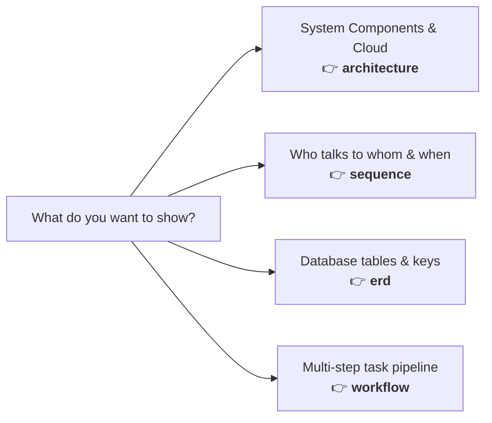

# Archify: Quick User Manual & Testing Results

---

## 1. What is Archify?

**Archify** turns simple text files (JSON) into **interactive, clickable visual diagrams** saved as a single HTML file. 

You don't need design software or complex tools. You write down what components exist and how they connect, and Archify automatically:
- Calculates positions so boxes don't overlap.
- Routes clean, readable arrows.
- Adds logos (React, FastAPI, PostgreSQL, Redis, etc.).
- Produces an HTML page with pan, zoom, click-to-highlight cards, and a dark/light theme switch.

---

## 2. Our Testing Results (Did It Work?)

We thoroughly tested Archify across all features. **Everything passed with a 100% success rate.**

### Test Summary:
- **System Health (`doctor`)**: 26 / 26 internal checks passed.
- **Core Engine Tests (`npm test`)**: 19 / 19 automated test suites passed.
- **Custom Diagrams Tested**:
  1. **Architecture Diagram** (`custom-rag.html`): High-level system design. *(Passed: 0 errors, 0 warnings)*
  2. **Sequence Diagram** (`custom-rag-sequence.html`): Step-by-step API message exchange. *(Passed: 0 errors, 0 warnings)*
  3. **Database Schema (ERD)** (`custom-rag-erd.html`): Tables, columns, and foreign keys. *(Passed: 0 errors, 0 warnings)*
  4. **Workflow Diagram** (`custom-rag-workflow.html`): Multi-lane background job pipeline. *(Passed: 0 errors, 0 warnings)*
  5. **Visual Diff (`compare`)** (`custom-rag-diff.html`): Side-by-side comparison showing what changed between v1 and v2. *(Passed)*

---

## 3. What We Learned from Errors (And How Archify Helped)

When we tested custom diagrams, we intentionally ran into common beginner mistakes. Here is how Archify handled them:

| Mistake | What Archify Told Us | How to Fix It |
| :--- | :--- | :--- |
| **Wrong JSON Format** | *"Missing required property: diagram_type, components"* | Use Archify's schema (`components` instead of `nodes`, `connections` instead of `edges`). |
| **Text Too Long for Box** | *"Label 'LLM Inference Endpoint' is wider than the node"* | Shorten the text (e.g. to `"LLM Inference"`) or make the box wider. |
| **Overlapping Labels** | *"Label overlaps component 'client' — set labelDy -22"* | Move the label slightly above the line (`labelDy: -22`) or widen the gap between boxes. |
| **Arrows Crossing** | *"Label is 0px from another arrow (minimum 4px)"* | Route one arrow out of the right side (`fromSide: "right"`) instead of crowding the top. |

> [!TIP]
> Archify never draws a messy diagram. If text would overlap or look cramped, it stops and tells you the exact number to adjust.

---

## 4. How to Use It (The Only 4 Commands You Need)

Open your terminal in the `archify/` directory:

### 1. Check if Archify is ready
```powershell
node bin/archify.mjs doctor
```

### 2. Validate your diagram JSON before rendering
```powershell
node bin/archify.mjs validate architecture my-file.json --quality showcase
```
*If anything overlaps or is missing, Archify will tell you here.*

### 3. Create the interactive HTML diagram
```powershell
node bin/archify.mjs render architecture my-file.json my-diagram.html
```
*Double-click `my-diagram.html` to open it in your browser!*

### 4. Compare two versions of a diagram (Visual Diff)
```powershell
node bin/archify.mjs compare architecture v1.json v2.json diff.html
```
*Highlights added components in green and removed ones in red.*

---

## 5. Diagram Types (Which One Should You Use?)

You don't need all 11 types right away. Here are the 4 most useful ones:



1. **`architecture`** — Best for overall systems: Web app, API, Database, Cache, and Cloud services.
2. **`sequence`** — Best for API flows: User sends query -> API verifies login -> Database returns rows -> App responds.
3. **`erd`** — Best for databases: Shows tables, fields, Primary Keys (`pk`), and Foreign Keys (`fk`).
4. **`workflow`** — Best for processes: Swimlanes showing who does what in a pipeline (e.g. Upload -> Parse -> Store).

---

## 6. Helpful Built-in Features

- **Brand Logos Built-in**: You don't need to download icons. Add `"brand": "react"`, `"fastapi"`, `"postgresql"`, `"redis"`, or `"openai"` to any component.
- **Scenario Guide**: Not sure which diagram to pick? Ask Archify:
  ```powershell
  node bin/archify.mjs guide "database for orders and products"
  ```
  It will tell you: *"Use ERD mode"* and give you tips.
- **Single-File HTML**: Everything (styles, scripts, graphics) is packed into one HTML file. You can email it, slack it, or open it offline without a web server.
- **Pan & Zoom**: Click and drag to move around, scroll wheel to zoom in and out.
- **Light & Dark Mode**: Has a button on the top-right of every diagram to switch themes.
